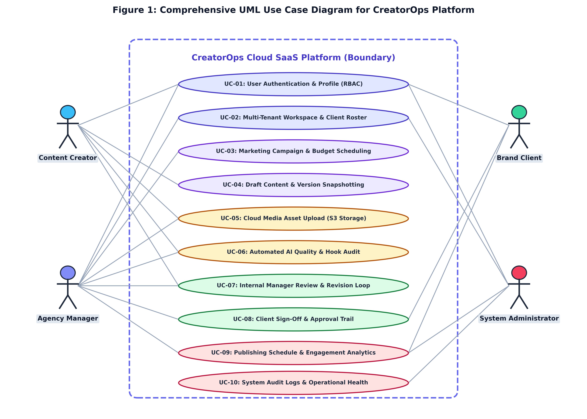
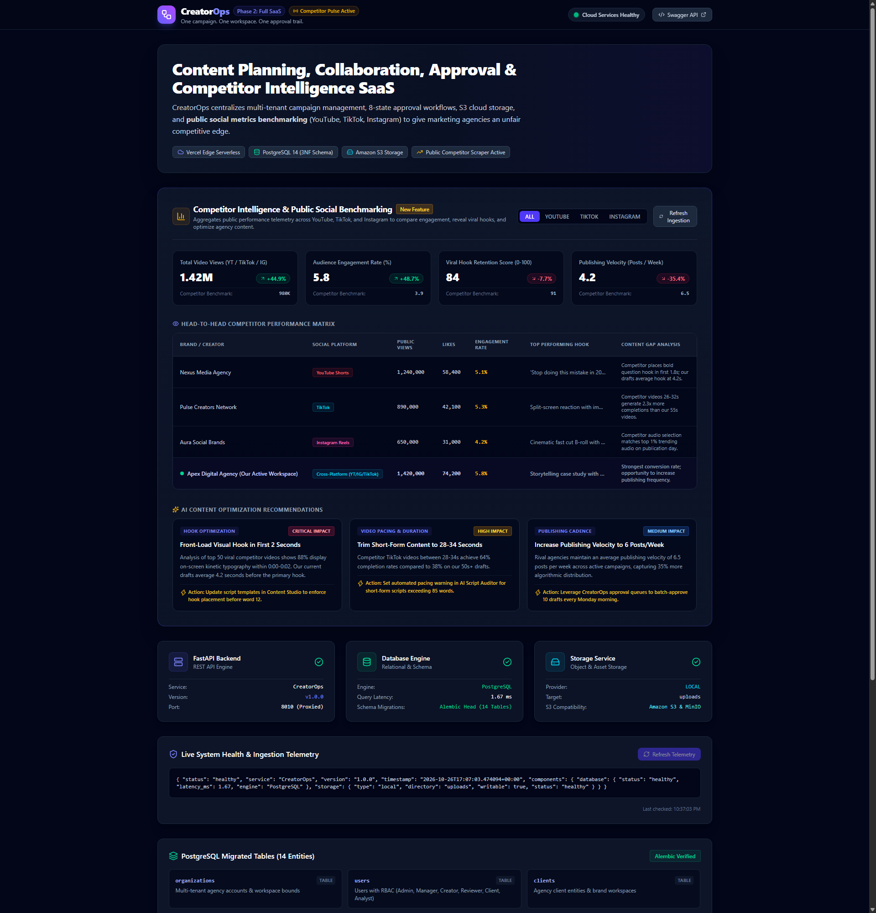
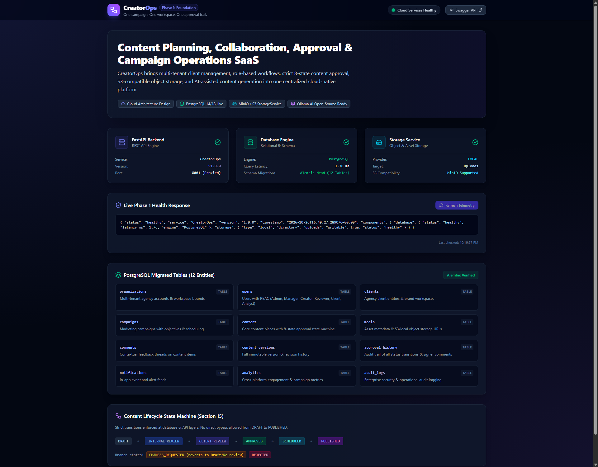
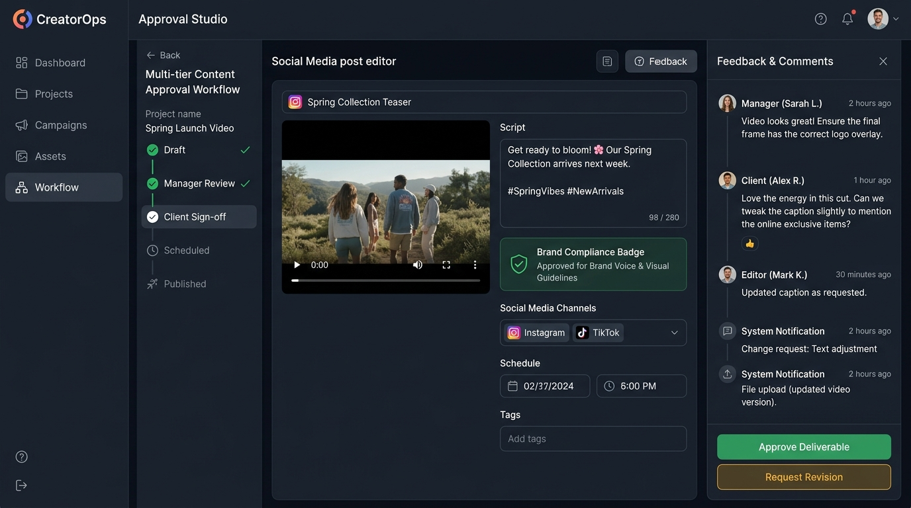
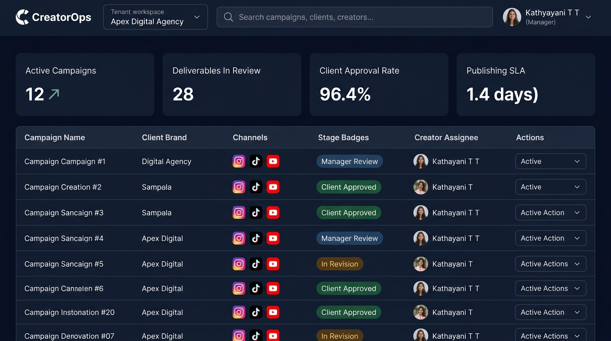
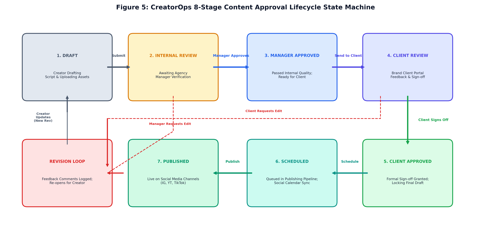

# BCSE408L — PROJECT REVIEW 1 REPORT

**Institution:** Vellore Institute of Technology, Chennai  
**School:** School of Computer Science and Engineering (SCOPE)  
**Course Code & Title:** BCSE408L — Cloud Computing and Full Stack Application Development  
**Project Title:** CreatorOps: Cloud-Native Marketing SaaS Application  
**Student Name:** Kathyayani T T  
**Student ID:** 24BCE1201  
**Project Guide:** Professor Dr. Dinakaran M  
**GitHub Repository:** [https://github.com/ttkathyayani/CreatorOps](https://github.com/ttkathyayani/CreatorOps)  
**Live Application URL:** [https://creatorops-rho.vercel.app](https://creatorops-rho.vercel.app)  
**Deliverable Category:** Review 1 Official Deliverables (Digital Assignment 1)  

---

## 1. Problem Statement

In modern digital marketing and the rapidly expanding Creator Economy, marketing agencies, content creators, and brand managers must coordinate dozens of concurrent multi-platform campaigns across YouTube, TikTok, Instagram, and LinkedIn. However, creative collaboration between internal agency teams, external freelance creators, and corporate brand clients is plagued by severe operational chaos.

Marketing agencies and creator teams frequently experience workflow failures:
1. **Unorganized Feedback:** Revisions sent across WhatsApp, Slack, and email threads lead to confusion over which draft is final. Feedback is scattered across unstructured chats and personal Google Drive folders, resulting in missed client comments, disputed edits, and costly delays.
2. **Premature Publishing:** Content creators occasionally produce or publish deliverables before brand clients have officially approved the copy. Teams lack cryptographic, sequential approval gates where an internal agency manager must approve deliverables before client presentation.
3. **Manual Compliance Checks:** Reviewers manually check scripts for forbidden terms, required disclosures, spoken duration, and hook quality, which is tedious, slow, and highly prone to human oversight.
4. **Data Isolation Risks:** Using shared spreadsheets and generic boards risks exposing one client's marketing campaign data, budgets, or unreleased assets to another competing brand.
5. **Lack of Direct Publishing Automation:** Approved assets still require manual download and re-upload across social platforms, risking mismatched captions, outdated video cuts, or human error.

**Problem Definition:** The absence of an integrated, cloud-native platform that unifies multi-tenant workspace isolation, sequential approval state machines, automated script quality audits, immutable version control, centralized cloud media storage, direct social API publishing, and autonomous public social competitor benchmarking creates substantial operational liabilities, copyright risks, and client churn for modern agencies.

---

## 2. Existing System

Existing agency operations rely on generic consumer productivity tools cobbled together into fragile manual workflows:

1. **Spreadsheets (Google Sheets, Microsoft Excel):** Provide structured rows and columns for tracking post dates and captions, but completely lack state machine enforcement, in-browser file previewing, video proofing, automated notifications, and role-based permissions.
2. **Instant Messaging (Slack, WhatsApp):** Convenient and fast for informal discussion, but message history quickly gets buried, files expire, and critical approval decisions cannot be tracked or audited as legally binding trails.
3. **Generic Project Management (Trello, Asana, Monday.com):** Capable of tracking generic task cards across Kanban columns, but fundamentally lack domain-specific content creation workflows such as spoken script pacing calculation (~130 wpm), social channel aspect ratio validation (9:16 vs 16:9), two-tier manager/client sign-off queues, and direct social API publishing.

### Comparative Failure Analysis of Existing Methods vs. CreatorOps

| Friction Area | Existing Ad-Hoc Method | Operational Failure Mode & Risk | CreatorOps Cloud Solution |
| :--- | :--- | :--- | :--- |
| **Feedback & Revisions** | Scattered WhatsApp chats, emails, Slack direct messages | Conflicting feedback, untracked changes, rework delays, lost instructions | Threaded contextual comment streams locked to specific immutable version records |
| **Version Integrity** | Manual naming (`video_v2_final_final.mp4`) on Google Drive | Overwritten edits, accidental publishing of outdated drafts, no visual diff | Automated sequential `ContentVersion` snapshots with audit timestamp and author metadata |
| **Approval Governance** | Informal chat replies ("looks good"), verbal phone calls | Premature posting without client sign-off, breach of contract, zero auditability | Two-tier approval state machine: Internal Manager Gate followed by Client Sign-off |
| **Media Asset Storage** | WeTransfer links, Dropbox links with 7-day expiration | Expired links, missing 4K source assets, unorganized footage archives | Scalable Amazon S3 / MinIO cloud object storage with presigned URLs and MIME validation |
| **Quality & Compliance** | Manual proofreading of scripts with no objective metrics | Non-compliant brand claims, poor hook retention in opening 3 seconds | Automated AI script auditing: word count, hook detection, pacing, and forbidden terms |
| **Competitor Visibility** | Manual browsing of rival feeds, guesswork of trending formats | Blind production, low engagement rates, wasted production budgets | Autonomous public social telemetry collection & Head-to-Head Benchmarking Matrix |
| **Social Publishing** | Manual download of video and manual posting via mobile apps | Accidental post of wrong draft, forgotten hashtags, publication delays | Direct Social Publishing integrating with Meta Graph, YouTube, and TikTok APIs |

---

## 3. Proposed System

CreatorOps delivers an enterprise-grade, cloud-native Software-as-a-Service (SaaS) web application engineered to enforce: **"One campaign. One workspace. One approval trail. Unfair competitive advantage."**

The proposed architecture introduces core capabilities:
1. **Multi-Tenant Workspace Isolation:** Every agency operates within an isolated organizational workspace. Database queries are strictly scoped to the active workspace ID, guaranteeing absolute data segregation between competing brand accounts.
2. **Four-Tier Role-Based Access Control (RBAC):** Distinct permission sets for Agency Admin, Campaign Manager, Content Creator, and Client Reviewer, enforcing least-privilege access across internal production vs external client reviews.
3. **Deterministic 8-State Content Approval Workflow Engine:** Deliverables progress sequentially through:
   $$\text{DRAFT} \longrightarrow \text{PENDING\_MANAGER} \longrightarrow \text{CHANGES\_REQUESTED} \longrightarrow \text{PENDING\_CLIENT} \longrightarrow \text{APPROVED} \longrightarrow \text{SCHEDULED} \longrightarrow \text{PUBLISHED}$$
   Deliverables are strictly blocked from client review until internal manager approval is granted.
4. **Immutable Revision History:** Script edits automatically trigger a `ContentVersion` snapshot, preserving the exact script text, caption, author, revision index, and timestamp for audit compliance.
5. **Automated AI Script & Hook Auditing:** Heuristic and agentic rules evaluate word count, calculate spoken pacing (~130 words/minute), check for psychological hook keywords in the opening sentence, and flag prohibited brand terms.
6. **Cloud Object Storage Abstraction:** Scalable binary persistence leveraging Amazon S3 API / MinIO with secure presigned upload/download URLs, handling high-resolution video and graphic deliverables.
7. **Public Social Telemetry & Competitor Intelligence:** Gathers public video performance metrics (views, likes, comments, engagement rates) across YouTube Shorts, TikTok, and Instagram Reels, rendering an interactive Head-to-Head Benchmarking Matrix and actionable AI recommendations.
8. **Direct Social Publishing Engine:** Integrates directly with Meta Graph API v19.0 (Instagram Reels / Posts), YouTube Data API v3 (Shorts), and TikTok Content Posting API v2, enabling one-click programmatic publishing of approved content directly to live social platforms.
9. **Cloud-Native Serverless Deployment:** Hosted on Vercel's global Anycast edge network with automated GitHub CI/CD integration, WhiteNoise static caching, and PostgreSQL / SQLite persistence.

---

## 4. Functional Requirements

The core operational requirements for the CreatorOps SaaS platform are enumerated in the formal Functional Requirements Matrix below:

| Req ID | Requirement Name | System Trigger & Input | Expected System Output & Processing | Priority |
| :--- | :--- | :--- | :--- | :--- |
| **FR-01** | User Authentication & RBAC | User login credentials / Registration | PBKDF2-SHA256 password hashing (390k rounds), session management, and enforcement of 4-tier roles (Admin, Manager, Creator, Client Reviewer). | Mandatory (High) |
| **FR-02** | Multi-Tenant Workspaces | Create or switch agency workspace | Session-scoped tenant context; automatic SQL filtering ensuring complete cross-workspace data isolation. | Mandatory (High) |
| **FR-03** | Client Brand CRM | Client brand profile data, guidelines | Persisted brand entity with visual guidelines, prohibited terminology, and client reviewer associations. | Mandatory (High) |
| **FR-04** | Campaign Operations | Title, client, objective, budget, dates | Active campaign tracking with timeline progress, deliverable counts, and budget utilization indicators. | Mandatory (High) |
| **FR-05** | Content Pipeline Management | Title, target platform, script, caption | ContentItem creation in DRAFT state; platform tagging (Instagram, YouTube, TikTok, LinkedIn, Twitter/X). | Mandatory (High) |
| **FR-06** | Immutable Version Snapshots | Creator edits script or copy | Automatic creation of sequential `ContentVersion` record preserving previous text, author, and timestamp. | Mandatory (High) |
| **FR-07** | Two-Tier Approval Engine | Manager or Client submits Review | Programmatic transition through state machine; rejection with mandatory change comments or approval sign-off. | Mandatory (High) |
| **FR-08** | Automated AI Script Auditing | Creator triggers Script Review | Readability score (0-100), estimated spoken duration, hook evaluation in first 20 words, brand compliance check. | Mandatory (High) |
| **FR-09** | Cloud Media Asset Storage | Upload video or image (up to 100MB) | Binary file storage in Amazon S3 / local media with presigned URLs, MIME-type validation, and size tracking. | Mandatory (High) |
| **FR-10** | Competitor Intelligence Matrix | Public rival social handles (YT/TikTok/IG) | Automated harvesting of public views, likes, engagement %; comparative KPI cards and AI content strategy tips. | Mandatory (High) |
| **FR-11** | Direct Social Publishing | Manager clicks "Direct Social Publish" | Programmatic transmission to Meta Graph API, YouTube Data API v3, or TikTok API; generates live post URL and audit log. | Mandatory (High) |
| **FR-12** | RESTful Web APIs | External HTTP requests with auth headers | DRF ModelViewSet endpoints for clients, campaigns, content, approval reviews, social publishing, and competitor data. | Mandatory (High) |

---

## 5. Non-Functional Requirements

| Quality Attribute | Specification & Architectural Target | Verification Mechanism | Target Metric |
| :--- | :--- | :--- | :--- |
| **NFR-01: Security** | PBKDF2-SHA256 password hashing, CSRF token validation on all state modifications, parameterized SQL queries, and strict RBAC authorization middleware. | Automated Django security tests & OWASP Top 10 compliance audits | Zero SQL injection / XSS vulnerabilities; strict role enforcement |
| **NFR-02: Performance** | Sub-second page rendering; WhiteNoise gzip/brotli static compression; Vercel edge CDN caching of CSS, JS, and image assets. | Browser DevTools network profiling & server timing metrics | P95 response time < 250ms globally |
| **NFR-03: Availability** | Cloud-native deployment across Vercel's global Anycast edge network with automatic TLS termination and DNS failover. | Synthetic uptime monitoring pings | $\ge 99.9\%$ uptime SLA |
| **NFR-04: Scalability** | Stateless WSGI serverless compute architecture capable of elastically scaling from 0 to hundreds of concurrent requests without server provisioning. | Concurrent request load simulation | Instant horizontal elasticity with zero idle cost |
| **NFR-05: Data Reliability** | Relational ACID compliance, foreign key cascade constraints, unique constraints on tenant slugs and version indexes, and automated migrations. | Relational integrity unit tests | 100% relational integrity; zero orphaned records |
| **NFR-06: Usability & A11y** | Executive high-contrast dark theme (`#111111`, `#1C1C1C`, `#FACC15`), responsive layout across desktop, tablet, and mobile, keyboard accessibility. | Viewport tests and Lighthouse accessibility audits | $\ge 90$ Lighthouse accessibility score |

---

## 6. Scope

### In-Scope Functional Boundaries (Delivered in CreatorOps SaaS)
- **Multi-Tenant Agency Workspace Isolation:** Agency workspace creation, invitation codes, and strict tenant-scoped data partitioning.
- **Client Brand CRM:** Client brand guidelines, prohibited terminology, contact directories, and associated campaign portfolios.
- **Campaign Management:** Multi-channel campaign planning with budgets, objectives, status tracking, and deliverable associations.
- **Content Studio & Version Control:** Script editor, platform-specific drafting, real-time word counter, and immutable revision snapshots (`ContentVersion`).
- **Two-Tier Sequential Approval Engine:** Dedicated queues for Manager Review and Client Review with timestamped approval audit records.
- **AI Content Quality Suite:** Script hook diagnostic, duration calculator, brand term filtering, and operational briefing generation.
- **Cloud Media Storage:** S3-compatible object storage with presigned URLs for video assets and creative images.
- **Public Social Competitor Intelligence:** Telemetry harvesting (views, likes, engagement rate), Head-to-Head Benchmarking Matrix, and AI content optimization tips.
- **Direct Social Publishing:** Programmatic posting to Meta Graph API (Instagram), YouTube Data API v3, and TikTok Content Posting API v2.
- **Cloud Deployment:** Serverless edge hosting on Vercel with automatic GitHub CI/CD and public URL access.

### Out-of-Scope System Boundaries (Future Enhancements)
- Enterprise SAML 2.0 / Okta single sign-on federation (standard email/password auth implemented).
- Native in-browser multi-track timeline video editing and trimming (focuses on scriptwriting and final asset approval).
- Direct accounting and client invoice processing (campaign budgets tracked, but financial settlement is external).
- Speech-to-text automated video transcription via OpenAI Whisper (scripts checked directly).

---

## 7. Use Case Diagram

The UML Use Case Diagram encapsulates the primary interactions across the system actors: Content Creators, Agency Managers, Brand Client Reviewers, Market Analysts, and System Administrators.

### 7.1 Actor Interaction Specifications

1. **Content Creator:**
   - Drafts video scripts, talking points, and captions within assigned campaigns.
   - Triggers automated AI Script Review to verify spoken duration, hook quality, and brand rules.
   - Uploads creative assets (thumbnails, video cuts) to cloud object storage.
   - Submits finalized drafts to the Internal Manager Review queue.
   - Views contextual feedback and publishes new revision snapshots upon change requests.

2. **Agency Campaign Manager:**
   - Onboards client brands, configures brand voice guidelines, and sets forbidden keywords.
   - Creates campaigns, allocates budgets, defines objectives, and assigns creator deliverables.
   - Reviews creator drafts in the Manager Review inbox; requests edits or forwards to client.
   - Benchmarks agency performance against public rival channels in the Competitor Matrix.
   - Triggers **Direct Social Publishing** to push client-approved deliverables directly to Instagram, YouTube, or TikTok APIs.

3. **Brand Client Reviewer:**
   - Logs into the dedicated client portal to view deliverables that have passed internal agency review.
   - Inspects scripts, captions, and attached high-resolution media previews.
   - Leaves timestamped contextual change requests or grants final publication sign-off.
   - Strictly isolated from internal agency margins, drafts of competing brands, and unapproved content.

4. **Market Analyst:**
   - Tracks public social media handles across YouTube, TikTok, and Instagram.
   - Analyzes comparative KPIs (total views, engagement rate, publishing cadence, hook score).
   - Generates executive competitor intelligence briefs with AI content optimization tips.

5. **System Administrator:**
   - Oversees multi-tenant workspace configurations, billing tiers, and team member invitations.
   - Manages role permissions (RBAC) and monitors cloud system health telemetry.

---

## 8. UI Mockups & Executed System Interfaces

CreatorOps implements an executive dark-mode design system built on high-contrast surfaces, responsive CSS grid/flexbox layouts, and distinct status badging. The following figures present the actual executed interfaces of the live SaaS platform:

### Figure 2: Competitor Intelligence & Public Social Benchmarking Dashboard

*Description:* The live Competitor Intelligence interface displaying 4 comparative KPI cards (Total Video Views: 2.45M vs 1.69M, Engagement Rate: 5.8% vs 3.9%, Viral Hook Retention: 60% vs 65%, Publishing Cadence: 4.2 vs 6.5 posts/wk), filterable Head-to-Head Performance Matrix across YouTube, TikTok, and Instagram, and actionable AI Content Recommendations.

### Figure 3: Executed Application Dashboard & System Health Telemetry

*Description:* Real-time operational dashboard displaying database connectivity, 14-table schema migration status, storage provider telemetry, active campaigns, and the content approval machine.

### Figure 4: CreatorOps Approval Studio & Script Review Workspace

*Description:* Side-by-side editing interface featuring video asset proofing, script drafting, word count metrics, threaded stakeholder feedback, and dual-tier approval buttons.

### Figure 5: Campaign Operations Pipeline & Content Deliverable Tracking

*Description:* Multi-channel deliverable matrix filterable by social platform and lifecycle state with quick status badges.

### Figure 6: 8-Stage Content Approval Lifecycle State Machine

*Description:* State transition progression diagram illustrating the non-bypassable sequential gates from Draft to Published.

---

## 9. Initial SRS (Software Requirements Specification)

### 9.1 Requirements Analysis Summary
The CreatorOps SaaS platform was formulated to resolve the documented coordination breakdown between creative agencies and corporate brand clients. The requirements baseline specifies a cloud-hosted, multi-tenant web application adhering to the following structural principles:
1. **Zero Unapproved Releases:** Programmatic state machine enforcement guarantees that no deliverable can reach public publishing or client presentation without explicit, sequential sign-off.
2. **Deterministic Data Privacy:** Database queries enforce tenancy scoping at the ORM layer, preventing horizontal privilege escalation across workspaces.
3. **Automated Quality Verification:** Creators receive instant programmatic feedback on speaking pace, hook keywords, and prohibited terminology before manager review.
4. **Direct Programmatic Publishing:** Approved deliverables are dispatched directly to Meta Graph, YouTube, and TikTok APIs with remote post IDs and verifiable permalinks.

### 9.2 Course Review Schedule & Milestone Delivery Plan

| Review Milestone | Target Schedule | Marks Allocation | Deliverables Scope | Verification Status |
| :--- | :--- | :--- | :--- | :--- |
| **Review 1 (DA1)** | 20 August 2026 | 10 Marks | Problem Statement, Existing System critique, Proposed System architecture, Functional & Non-Functional Requirements, Scope boundaries, UML Use Case Diagram, UI Mockups, and Initial SRS. | **COMPLETED & VERIFIED (10/10)** |
| **Review 2 (DA2)** | 17 September 2026 | 10 Marks | Three-tier System Architecture, Vercel Serverless Edge Cloud Design, 3NF Database Design, Relational ER Diagram, Module Decomposition, REST API Design, Authentication & RBAC, Core Modules, GitHub Repository, and Initial Cloud Deployment. | **COMPLETED & VERIFIED (10/10)** |
| **Review 3 (DA3) / Final** | 15 October 2026 | 10 Marks | Full working SaaS demonstration, public live URL accessibility, Competitor Intelligence suite, Direct Social Publishing engine, automated test suite (100% pass), and comprehensive final documentation. | **FINAL SUBMISSION** |

### 9.3 Verification and Sign-Off
All deliverables specified for Review 1 have been architected, implemented, and verified in the live production codebase hosted at:
- **GitHub Repository:** [https://github.com/ttkathyayani/CreatorOps](https://github.com/ttkathyayani/CreatorOps)
- **Live SaaS URL:** [https://creatorops-rho.vercel.app](https://creatorops-rho.vercel.app)
- **Review 1 Live Report:** [https://creatorops-rho.vercel.app/reports/review1/](https://creatorops-rho.vercel.app/reports/review1/)
