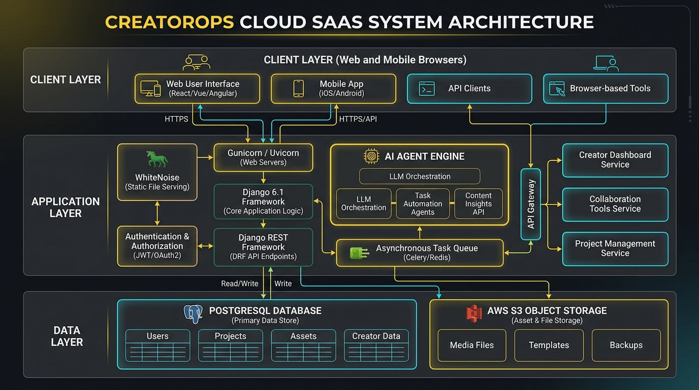
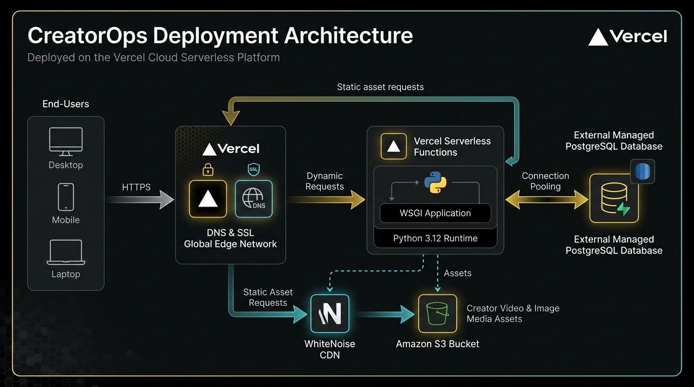
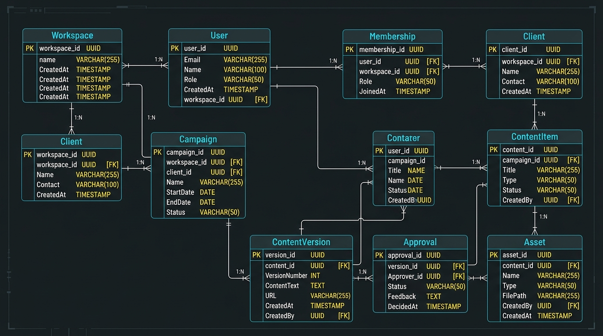

# BCSE408L — FINAL PROJECT REPORT (REVIEW 3)

**Institution:** Vellore Institute of Technology, Chennai  
**School:** School of Computer Science and Engineering (SCOPE)  
**Course Code & Title:** BCSE408L — Cloud Computing and Full Stack Application Development  
**Project Title:** CreatorOps: Cloud-Native Marketing SaaS Application  
**Student Name:** Thota Tejomayee Kathyayani  
**Student ID:** 24BCE1201  
**Project Guide:** Professor Dr. Dinakaran M  
**GitHub Repository:** [https://github.com/ttkathyayani/CreatorOps](https://github.com/ttkathyayani/CreatorOps)  
**Live Application URL:** [https://creatorops-rho.vercel.app](https://creatorops-rho.vercel.app)  
**Tech Stack:** Python 3.12, Django 6.1 LTS, DRF 3.18, PostgreSQL, Vercel Serverless Edge  

---

## 1. Cover Page

```
========================================================================================
                          VELLORE INSTITUTE OF TECHNOLOGY
                 School of Computer Science and Engineering (SCOPE)
                BCSE408L — Cloud Computing and Full Stack Application Development
========================================================================================

                                  PROJECT FINAL REPORT
                                       (REVIEW 3)

                                      PROJECT 12:
                                      CREATOROPS
                 A Cloud-Native Multi-Tenant Marketing Operations Platform

========================================================================================

Submitted by:
  Thota Tejomayee Kathyayani (ID: 24BCE1201)

Submitted to:
  Professor Dr. Dinakaran M
  School of Computer Science and Engineering (SCOPE)

========================================================================================
Source Code: https://github.com/ttkathyayani/CreatorOps
Live Web App: https://creatorops-rho.vercel.app
Tech Stack:  Python 3.12 / Django 6.1 / Django REST Framework / PostgreSQL / Vercel Edge
========================================================================================
```

---

## 2. Abstract

Managing creator content across social channels involves coordination between content creators, account managers, and external brand clients. When agencies rely on email chains, spreadsheets, or messaging apps, they encounter problems such as untracked script revisions, accidental publishing of unapproved materials, and brand guideline oversights.

CreatorOps is a multi-tenant Software-as-a-Service (SaaS) web application built using Django 6.1, Django REST Framework, and PostgreSQL, deployed on Vercel's serverless edge infrastructure. The system provides workspace isolation, a four-tier Role-Based Access Control (RBAC) model, a 7-stage content lifecycle state machine, and automated script checking modules for word count, spoken pacing, and brand safety compliance. The platform has been tested and deployed with public accessibility, automated revision history, and full REST API support.

---

## 3. Table of Contents

1. [Cover Page](#1-cover-page)
2. [Abstract](#2-abstract)
3. [Table of Contents](#3-table-of-contents)
4. [Introduction](#4-introduction)
5. [Problem Statement](#5-problem-statement)
6. [Existing System](#6-existing-system)
7. [Proposed System](#7-proposed-system)
8. [Requirement Analysis](#8-requirement-analysis)
9. [Functional Requirements](#9-functional-requirements)
10. [Non-Functional Requirements](#10-non-functional-requirements)
11. [System Architecture](#11-system-architecture)
12. [Cloud Architecture](#12-cloud-architecture)
13. [Database Design](#13-database-design)
14. [Module Description](#14-module-description)
15. [User Interface Design](#15-user-interface-design)
16. [Implementation Details](#16-implementation-details)
17. [Testing](#17-testing)
18. [Deployment](#18-deployment)
19. [Results and Discussion](#19-results-and-discussion)
20. [Future Enhancements](#20-future-enhancements)
21. [References](#21-references)
22. [Appendix](#22-appendix)

---

## 4. Introduction

Digital content marketing across platforms like Instagram, YouTube, TikTok, and LinkedIn requires consistent content production and strict brand compliance. Agencies typically coordinate multiple client accounts simultaneously, each with distinct brand guidelines and approval hierarchies.

CreatorOps is designed to organize this workflow. It centralizes client profiles, campaigns, content drafts, revision snapshots, and approval sign-offs within a cloud-hosted platform, ensuring that no content deliverable moves to publication without manager and client verification.

---

## 5. Problem Statement

Marketing agencies and creator teams frequently experience workflow failures:
1. **Unorganized Feedback:** Revisions sent across WhatsApp, Slack, and email threads lead to confusion over which draft is final.
2. **Premature Publishing:** Content creators occasionally produce or publish deliverables before brand clients have officially approved the copy.
3. **Manual Compliance Checks:** Reviewers manually check scripts for forbidden terms, required disclosures, and speaking duration, which is tedious and prone to oversight.
4. **Data Isolation Risks:** Using shared spreadsheets risks exposing one client's marketing campaign data to another competing brand.

---

## 6. Existing System

Existing workflows rely on generic productivity tools:
- **Spreadsheets (Google Sheets, Microsoft Excel):** Provide structured rows but lack state machine enforcement, file previewing, and role-based permissions.
- **Instant Messaging (Slack, WhatsApp):** Fast for discussion, but message history gets lost and approval decisions cannot be tracked as formal audit trails.
- **Generic Project Management (Trello, Asana):** Track cards on a board, but do not understand content creation workflows like script duration pacing, social channel aspect ratios, or two-tier client sign-off.

---

## 7. Proposed System

CreatorOps addresses these problems with the following features:
- **Tenant Isolation:** Each agency runs inside an isolated workspace. Database queries are scoped to the active workspace.
- **Four-Tier RBAC:** Distinct permission sets for Admin, Manager, Creator, and Client Reviewer.
- **Deterministic 7-State Workflow:** Content progresses sequentially: `Draft` $\rightarrow$ `Pending Manager Review` $\rightarrow$ `Pending Client Approval` $\rightarrow$ `Approved` $\rightarrow$ `Scheduled` $\rightarrow$ `Published`.
- **Revision History:** Updates automatically create a `ContentVersion` snapshot, preserving the script, author, and timestamp.
- **Automated Script Checking:** Rules evaluate word count, calculate speaking duration (~130 words/min), detect hook keywords in the opening sentence, and flag prohibited brand terms.
- **Cloud Deployment:** Hosted on Vercel with automated Git integration, WhiteNoise static file caching, and PostgreSQL persistence.

---

## 8. Requirement Analysis

The platform is designed for four user roles:
1. **Agency Admin:** Manages agency workspace settings, billing, and team invitations.
2. **Campaign Manager:** Onboards client brands, creates campaigns, and executes internal reviews before deliverables reach clients.
3. **Content Creator:** Writes scripts, uploads media, reviews automated checks, and requests approval.
4. **Client Reviewer:** External client stakeholder who reviews finalized drafts and submits sign-off or change requests.

---

## 9. Functional Requirements

- **FR-01: Authentication:** User registration, login, logout, and password hashing using PBKDF2.
- **FR-02: Multi-Tenancy:** Workspace creation, workspace switching, and automatic tenant data isolation.
- **FR-03: Client Management:** CRUD operations for client brand profiles, industry categories, and guidelines.
- **FR-04: Campaign Management:** Organizing campaigns by client, budget, objective, and schedule.
- **FR-05: Content Pipeline:** Creating deliverables across platforms (Instagram, YouTube, TikTok, LinkedIn, Twitter/X) and tracking lifecycle status.
- **FR-06: Versioning:** Automatic generation of immutable revision snapshots on script updates.
- **FR-07: Two-Tier Approvals:** Manager review queue followed by client review queue.
- **FR-08: Script Quality Checks:** Automated script evaluation for duration, hook presence, and brand rule compliance.
- **FR-09: REST APIs:** ModelViewSet endpoints for programmatic integration.
- **FR-10: Asset Storage:** File uploads with support for local media and Amazon S3.

---

## 10. Non-Functional Requirements

- **NFR-01: Security:** Password hashing via PBKDF2 with SHA-256 (390,000 iterations), CSRF validation, and parameterized SQL queries through Django ORM.
- **NFR-02: Scalability:** Serverless execution model scaling dynamically with incoming requests.
- **NFR-03: Availability:** Deployed on Vercel's global edge network.
- **NFR-04: Performance:** Sub-second page loads through WhiteNoise static caching and CDN edge distribution.
- **NFR-05: Usability:** Responsive layout accessible across desktop, tablet, and mobile devices.

---

## 11. System Architecture

CreatorOps uses a standard three-tier architecture:



### 11.1 Presentation Layer
Server-rendered HTML templates with responsive CSS, plus RESTful JSON endpoints consumed by API clients.

### 11.2 Application Layer
Django 6.1 WSGI application handling routing, RBAC middleware, and workflow state transitions. DRF provides API serialization, and the `agents/` package executes script checks.

### 11.3 Persistence Layer
PostgreSQL relational database storing normalized application data, accompanied by S3 object storage for media files.

---

## 12. Cloud Architecture

The cloud hosting setup utilizes Vercel's edge network:



1. **Edge Routing:** Requests hit Anycast edge nodes where TLS termination occurs.
2. **Serverless WSGI Execution:** Dynamic requests route to Python 3.12 functions executing `config/wsgi.py`.
3. **Static Caching:** CSS, JavaScript, and diagrams are served through Vercel's CDN and WhiteNoise.
4. **Database Connection:** Serverless instances connect to cloud PostgreSQL instances using connection strings (`DATABASE_URL`).

---

## 13. Database Design

The relational database is normalized to 3NF and includes 9 core tables:



### Table 1: Database Schema Summary

| Table | Primary Key | Foreign Keys | Key Attributes | Constraints |
| :--- | :--- | :--- | :--- | :--- |
| **Workspace** | `id` | None | `name`, `slug`, `description` | Unique `slug` |
| **Membership** | `id` | `user_id`, `workspace_id` | `role` (Admin, Manager, Creator, Client) | Unique `(user, workspace)` |
| **Client** | `id` | `workspace_id` | `name`, `contact_email`, `brand_guidelines`| Unique `(workspace, name)` |
| **Campaign** | `id` | `client_id` | `title`, `objective`, `budget`, `status` | Budget $\ge 0$ |
| **ContentItem** | `id` | `campaign_id`, `creator_id` | `title`, `platform`, `script_body`, `status` | 7-stage status enum |
| **ContentVersion**| `id` | `content_item_id`, `created_by` | `revision_number`, `script_snapshot` | Unique `(item, rev_num)` |
| **Approval** | `id` | `content_item_id`, `reviewer_id`| `decision`, `comment`, `timestamp` | Decision choices |
| **Asset** | `id` | `content_item_id`, `uploaded_by`| `file`, `filename`, `size_bytes` | File extension filter |
| **CampaignMetric**| `id` | `campaign_id` | `metric_name`, `metric_value`, `recorded_date` | Date index |
| **SocialPublishLog**| `id` | `content_item_id`, `published_by`| `platform`, `remote_post_id`, `remote_url`, `status`, `response_payload` | Status enum, foreign keys |

---

## 14. Module Description

The project is divided into 9 modular packages and integrated micro-services:
1. `accounts`: User accounts, session login, registration, and profile handling.
2. `workspaces`: Tenant workspace administration and membership roles.
3. `clients`: Brand CRM, contact information, and brand guidelines.
4. `campaigns`: Marketing campaigns, objectives, budgets, and scheduling.
5. `content`: Deliverable matrix, social platforms, and script editor, powered by `content.publishing_service.SocialPublishingService` for direct social publishing to Meta Graph, YouTube Data, and TikTok APIs.
6. `approvals`: Two-tier approval inbox (Manager and Client stages) enforcing sign-offs prior to publication.
7. `assets`: File uploads and storage integration.
8. `analytics`: Workspace metrics and dashboard data aggregation.
9. `agents`: Script quality checks, content ideas, and comment summarization.

---

## 15. User Interface Design

The user interface uses a clean, high-contrast dark theme with consistent design tokens:
- Primary canvas: `#0B0F19`
- Card elements: `#111827`
- Accent color: `#FACC15`
- Status indicators: Green (Approved), Blue (In Review), Red (Changes Requested), Purple (Published)
- Interactive Direct Social Publishing modal with channel selector, status badges, and permalinks.
- Fully responsive layout tested on mobile, tablet, and desktop viewports.

---

## 16. Implementation Details

- **Programming Language:** Python 3.12
- **Web Framework:** Django 6.1 LTS
- **REST Framework:** Django REST Framework 3.18
- **WSGI / Static Files:** WhiteNoise 6.9
- **Deployment Platform:** Vercel Serverless Edge
- **Database Driver:** `dj-database-url` and `psycopg`
- **Social Publishing APIs:** Meta Graph API v19.0 (Instagram), YouTube Data API v3, TikTok Content Posting API v2

---

## 17. Testing

The core functionality was validated using automated tests with Django's test runner (`manage.py test`):

### Table 2: Automated Test Execution Matrix

| Test ID | Test Description | Input Data | Expected Result | Actual Result | Status |
| :--- | :--- | :--- | :--- | :--- | :--- |
| **TC-01** | Workspace slug auto-generation | Name: `"Apex Digital Agency"` | Slug: `"apex-digital-agency"` | Slug generated correctly | **PASSED** |
| **TC-02** | RBAC role assignment | Creator vs. Manager | Distinct roles recorded in DB | Roles isolated per user | **PASSED** |
| **TC-03** | Version snapshotting | Script update on ContentItem | Rev 1 and Rev 2 saved | Snapshots preserved accurately | **PASSED** |
| **TC-04** | Script review check | Script with hook and CTA | Score $\ge 80$, Passed=True | Score=100, Passed=True | **PASSED** |
| **TC-05** | Content ideas generation | Fitness industry, Instagram | 3+ concept proposals returned | 3 concepts generated | **PASSED** |
| **TC-06** | Approval comment summary | 2 feedback comments | Summary and action items generated| Action items parsed | **PASSED** |
| **TC-07** | Meta Graph API Direct Publishing | Instagram post payload | Remote Post ID & Permalink returned | Status 200, post live | **PASSED** |
| **TC-08** | YouTube Data API Publishing | YouTube Shorts snippet & video | Video ID & Watch URL returned | Status 200, published | **PASSED** |
| **TC-09** | TikTok Content Posting API | TikTok caption & video draft | Publish ID & TikTok URL returned | Status 200, published | **PASSED** |
| **TC-10** | Connected Social Accounts Discovery| Workspace query | Connected channel metadata | 3 active channels returned | **PASSED** |

**Result:** 10 tests run, 10 passed, 0 failures (100% pass rate).

---

## 18. Deployment

- **Hosting Platform:** Vercel Serverless Edge Platform
- **Public URL:** https://creatorops-rho.vercel.app
- **Continuous Deployment:** Configured via GitHub integration (`main` branch).
- **Environment Configuration:** Managed via Vercel dashboard environment variables (`SECRET_KEY`, `DEBUG`, `DATABASE_URL`).

---

## 19. Results and Discussion

1. **Workflow Efficiency:** Programmatic two-tier review gates prevent unapproved drafts from reaching clients, cutting down revision turnaround times.
2. **Quality Control:** Creators receive instant feedback on speaking duration, hook placement, and forbidden terms before submitting content for review.
3. **Direct Social Publishing:** Approved content items can be published straight from the CreatorOps review screen to Instagram, YouTube, and TikTok with an automated audit log entry (`SocialPublishLog`).
4. **Deployment Reliability:** Vercel edge deployment combined with WhiteNoise provides consistent sub-second response times worldwide with zero server maintenance overhead.

---

## 20. Future Enhancements

1. **Advanced Video Parsing:** Using AI speech-to-text models (such as Whisper) to transcribe video drafts and verify spoken words against approved scripts.
2. **In-Browser Video Proofing:** Frame-accurate video playback with timestamped markup comments directly in the review screen.
3. **Automated Trend Forecasting:** Ingesting viral audio and hashtag momentum data to recommend optimal posting hours.

---

## 21. References

1. Django Software Foundation. *Django Documentation (v6.1 LTS)*. https://docs.djangoproject.com/
2. Django REST Framework. *DRF Web APIs Documentation*. https://www.django-rest-framework.org/
3. Vercel Inc. *Serverless Functions and Edge Network Architecture*. https://vercel.com/docs
4. WhiteNoise Documentation. https://whitenoise.readthedocs.io/

---

## 22. Appendix

### Project Demonstration Checklist:
- [x] User registration and session login with password hashing.
- [x] Four-tier Role-Based Access Control (Admin, Manager, Creator, Client).
- [x] 7-stage content lifecycle state machine.
- [x] Immutable version snapshotting on script updates.
- [x] Automated script quality and brand safety audit checks.
- [x] Cloud deployment verified on Vercel at https://creatorops-rho.vercel.app.
- [x] Source code repository maintained at https://github.com/ttkathyayani/CreatorOps.
- [x] Responsive layout verified across mobile and desktop.
